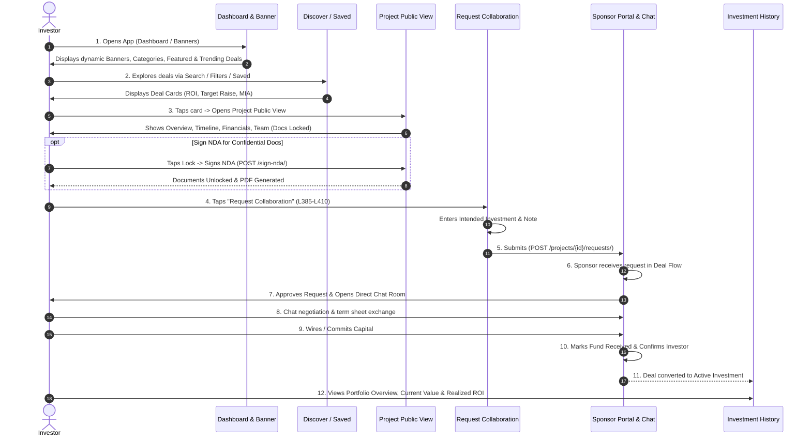

# Complete Investor Role — End-to-End Flow & Backend API Specification

Comprehensive blueprint covering all screens, navigation flows, and API contracts for the **Investor** module.

---

## 1. End-to-End Investor Lifecycle Flow (Visual Map)



---

## 2. Screen-by-Screen API Specifications

---

### 2.1. Investor Dashboard & Banner Carousel
**Files:**
- `lib/views/investor/dashboard/screens/investor_dashboard.dart`
- `lib/views/investor/dashboard/widgets/investor_banner_carousel.dart`

#### A. Promotional Banners API
- **Method:** `GET`
- **Endpoint:** `/api/v1/banners/?role=investor`
- **Auth:** Optional / Bearer Token

```json
{
  "success": true,
  "data": [
    {
      "id": "banner_1",
      "title": "Downtown Tech Hub",
      "location": "United States",
      "target_raise": "$5.0M",
      "subtitle": "Direct co-investment opportunities with verified lead syndicates.",
      "tag": "High Yield",
      "image_url": "https://images.unsplash.com/photo-1497366216548-37526070297c?q=80&w=600",
      "action_text": "Request",
      "action_url": "/public-view",
      "target_project_id": "proj_downtown_tech"
    },
    {
      "id": "banner_2",
      "title": "Solar Energy Park",
      "location": "Spain",
      "target_raise": "$12.5M",
      "subtitle": "Institutional grade sustainable clean energy utility.",
      "tag": "Featured",
      "image_url": "https://images.unsplash.com/photo-1785990137771-1cb6d4a63637?q=80&w=600",
      "action_text": "Request",
      "action_url": "/public-view",
      "target_project_id": "proj_solar_park"
    }
  ]
}
```

#### B. Categories (Industry Filters)
- **Method:** `GET`
- **Endpoint:** `/api/v1/profiles/industries/`

```json
{
  "success": true,
  "data": [
    {"id": "ind_1", "name": "Real Estate"},
    {"id": "ind_2", "name": "Tech"},
    {"id": "ind_3", "name": "Health"},
    {"id": "ind_4", "name": "Energy"},
    {"id": "ind_5", "name": "Agriculture"}
  ]
}
```

#### C. Featured & Trending Opportunities Feed
- **Method:** `GET`
- **Endpoint:** `/api/v1/projects/?category={category}&is_featured=true&is_trending=true`

```json
{
  "success": true,
  "data": {
    "featured": [
      {
        "id": "proj_9876",
        "title": "Downtown Tech Hub",
        "location": "United States",
        "category": "Real Estate",
        "image_url": "https://images.unsplash.com/photo-1497366216548-37526070297c?q=80&w=400",
        "target_raise": "$5.0M",
        "target_roi": "~ 18%",
        "funded_percent": 0.75
      }
    ],
    "trending": [
      {
        "id": "proj_1122",
        "title": "BioTech Diagnostics Gene Test",
        "location": "Switzerland",
        "category": "Health",
        "image_url": "https://images.unsplash.com/photo-1532187863486-abf9dbad1b69?q=80&w=400",
        "funded_percent": 0.82,
        "min_investment": "$10,000",
        "days_left": 5,
        "target_roi": "~ 22%"
      }
    ]
  }
}
```

---

### 2.2. Saved Items & Bookmarks View
**File:** `lib/views/investor/saved/screens/investor_saved_view.dart`

#### A. Fetch Saved Projects with Stats Header
- **Method:** `GET`
- **Endpoint:** `/api/v1/projects/saved/`
- **Query Params:**
  - `filter` (`All` | `Active` | `Pending` | `Newest` | `Highest ROI` | `Closing Soon`)
  - `page` & `page_size`
- **Auth:** Bearer Token

```json
{
  "success": true,
  "data": {
    "summary": {
      "total_committed": "$900k",
      "active_projects_count": 3,
      "pending_ndas_count": 1
    },
    "count": 4,
    "results": [
      {
        "id": "proj_9876",
        "saved_item_id": "save_01",
        "title": "Downtown Tech Hub",
        "category": "Real Estate",
        "saved_date": "2026-02-22T00:00:00.000Z",
        "formatted_date": "Feb 22, 2026",
        "status": "Active",
        "invested": "$250k",
        "value": "$288k",
        "target_roi": "+15.0%",
        "funding_progress": 0.24,
        "image_url": "https://images.unsplash.com/photo-1486406146926-c627a92ad1ab?q=80&w=300"
      },
      {
        "id": "proj_5544",
        "saved_item_id": "save_02",
        "title": "AI Logistics Platform",
        "category": "Tech",
        "saved_date": "2026-02-22T00:00:00.000Z",
        "formatted_date": "Feb 22, 2026",
        "status": "Active",
        "invested": "$150k",
        "value": "$173k",
        "target_roi": "+15.0%",
        "funding_progress": 0.67,
        "image_url": "https://images.unsplash.com/photo-1518770660439-4636190af475?q=80&w=300"
      }
    ]
  }
}
```

#### B. Toggle Save / Bookmark
- **Method:** `POST`
- **Endpoint:** `/api/v1/projects/{project_id}/save/`

```json
{
  "success": true,
  "is_saved": true,
  "message": "Project saved successfully."
}
```

---

### 2.3. Project Public Deal Room (Investor View) & NDA
**File:** `lib/views/sponsor/public_view/screens/project_public_view.dart` (L385-L410)

#### A. Fetch Full Public Project Details
- **Method:** `GET`
- **Endpoint:** `/api/v1/projects/{project_id}/`
- **Auth:** Bearer Token

```json
{
  "success": true,
  "data": {
    "id": "proj_9876",
    "title": "Downtown Tech Hub",
    "sponsor_name": "Acme Capital",
    "sponsor_id": "usr_sponsor_1",
    "sponsor_avatar": "https://images.unsplash.com/photo-1534528741775-53994a69daeb?q=80&w=150",
    "location": "United States",
    "category": "Real Estate",
    "description": "Prime tech district mixed-use development with high rental yields.",
    "target_raise": "$5,000,000",
    "min_contribution": "$1,000",
    "target_roi": "~ 18%",
    "projected_duration": "36 Months",
    "funded_percentage": 0.75,
    "is_saved": false,
    "nda_signed": false,
    "image_urls": [
      "https://images.unsplash.com/photo-1497366216548-37526070297c?q=80&w=600"
    ],
    "documents": [
      {
        "id": "doc_01",
        "name": "Executive Summary & Financial Model.pdf",
        "is_locked": true,
        "file_url": null
      }
    ]
  }
}
```

#### B. Sign NDA to Unlock Documents
- **Method:** `POST`
- **Endpoint:** `/api/v1/projects/{project_id}/sign-nda/`
- **Request:**
```json
{
  "full_name": "John Doe",
  "signature_date": "2026-10-08",
  "accepted_terms": true
}
```
- **Response `200 OK`:**
```json
{
  "success": true,
  "message": "NDA signed successfully. Documents unlocked.",
  "data": {
    "nda_id": "nda_9988",
    "pdf_url": "https://storage.googleapis.com/damini-ai/nda/nda_9988.pdf",
    "unlocked_documents": [
      {
        "id": "doc_01",
        "name": "Executive Summary & Financial Model.pdf",
        "is_locked": false,
        "file_url": "https://storage.googleapis.com/damini-ai/docs/doc_01.pdf"
      }
    ]
  }
}
```

---

### 2.4. Request Collaboration & The Complete Next Flow
**File:** `lib/views/investor/request_collaboration/screens/request_collaboration_screen.dart`

#### Step 1: Investor Submits Request
- **Method:** `POST`
- **Endpoint:** `/api/v1/projects/{project_id}/requests/`
- **Request Body:**
```json
{
  "proposed_budget": 250000,
  "message": "We are ready to participate in this round as a lead investor."
}
```
- **Response `201 Created`:**
```json
{
  "success": true,
  "message": "Collaboration request submitted successfully.",
  "data": {
    "request_id": "collab_req_5544",
    "project_id": "proj_9876",
    "investor_id": "usr_inv_99",
    "status": "PENDING",
    "proposed_budget": 250000,
    "message": "We are ready to participate in this round as a lead investor.",
    "created_at": "2026-10-08T10:50:00.000Z"
  }
}
```

---

### 🔥 NEXT FLOW (What Happens After Request Submission)

#### Step 2: Sponsor Views & Evaluates Request
- **Method:** `GET`
- **Endpoint:** `/api/v1/projects/sponsor/requests/` (or `/api/v1/projects/sponsor/{project_id}/requests/`)
- Returns all incoming investor requests with investor profile, proposed budget, note, and verification badge.

#### Step 3: Sponsor Approves or Rejects
- **Approve Request:**
  - **Method:** `POST`
  - **Endpoint:** `/api/v1/projects/sponsor/requests/{request_id}/approve/`
  - **Action:** Creates direct chat between Investor and Sponsor. Status changes to `APPROVED`.
- **Reject Request:**
  - **Method:** `POST`
  - **Endpoint:** `/api/v1/projects/sponsor/requests/{request_id}/reject/`
  - **Request:** `{"reason": "Allocation full"}`

#### Step 4: Sponsor & Investor Direct Chat Room
- **Method:** `POST`
- **Endpoint:** `/api/v1/notifications/chat/conversations/start/`
- **Request Body:** `{"project_id": "proj_9876", "target_user_id": "usr_sponsor_1"}`
- Opens real-time chat for sharing term sheets, bank transfer details, and syndicate updates.

#### Step 5: Fund Received & Confirm Investors
- **Mark Funds Received:**
  - **Method:** `POST`
  - **Endpoint:** `/api/v1/projects/sponsor/requests/{request_id}/fund-received/`
- **Confirm Investor in Project Syndicate:**
  - **Method:** `POST`
  - **Endpoint:** `/api/v1/projects/{project_id}/confirm-investors/`
  - **Request:** `{"confirmed_investor_ids": ["usr_inv_99"]}`
  - **Action:** Triggers addition of project to Investor's **Investment History** as `Active`.

---

### 2.5. Investment History & Portfolio Overview
**File:** `lib/views/investor/investment_history/screens/investment_history_screen.dart`

#### List Active & Historical Investments with Portfolio Totals
- **Method:** `GET`
- **Endpoint:** `/api/v1/investor/investments/`
- **Query Params:**
  - `status` (`All` | `Active` | `Completed` | `Pending`)
  - `page` & `page_size`
- **Auth:** Bearer Token

#### Response `200 OK`
```json
{
  "success": true,
  "data": {
    "summary": {
      "total_invested": "$560,000",
      "total_current_value": "$644,200",
      "total_profit_loss": "+$84,200",
      "total_roi_percentage": "+15.0%",
      "active_deals_count": 4
    },
    "count": 4,
    "results": [
      {
        "id": "inv_hist_1",
        "project_id": "proj_9876",
        "title": "Downtown Tech Hub",
        "category": "Real Estate",
        "sponsor": "Acme Corp",
        "date": "Mar 14, 2026",
        "status": "Active",
        "invested": "$250,000",
        "current_value": "$288,000",
        "roi": "+15.2%",
        "image_url": "https://images.unsplash.com/photo-1486406146926-c627a92ad1ab?q=80&w=300"
      },
      {
        "id": "inv_hist_2",
        "project_id": "proj_5544",
        "title": "AI Logistics Platform",
        "category": "Tech",
        "sponsor": "Nexus AI",
        "date": "Feb 22, 2026",
        "status": "Active",
        "invested": "$150,000",
        "current_value": "$173,000",
        "roi": "+15.3%",
        "image_url": "https://images.unsplash.com/photo-1518770660439-4636190af475?q=80&w=300"
      },
      {
        "id": "inv_hist_3",
        "project_id": "proj_3322",
        "title": "EcoTech Solar Farm",
        "category": "Energy",
        "sponsor": "Green Grid Ltd",
        "date": "Jan 10, 2026",
        "status": "Completed",
        "invested": "$100,000",
        "current_value": "$118,500",
        "roi": "+18.5%",
        "image_url": "https://images.unsplash.com/photo-1509391365360-2e959784a276?q=80&w=300"
      },
      {
        "id": "inv_hist_4",
        "project_id": "proj_7788",
        "title": "AeroDynamics Drone Fleet",
        "category": "Aviation",
        "sponsor": "Sky Tech Ventures",
        "date": "Nov 05, 2025",
        "status": "Pending",
        "invested": "$60,000",
        "current_value": "$64,700",
        "roi": "+7.8%",
        "image_url": "https://images.unsplash.com/photo-1508614589041-895b88991e3e?q=80&w=300"
      }
    ]
  }
}
```

---

## 3. UI Key Mapping Table for All Files

| Screen / Widget | Flutter Field | Backend JSON Field | Type |
|---|---|---|---|
| **Banner Carousel** | `item.title` | `title` | `String` |
| | `item.location` | `location` | `String` |
| | `item.targetRaise` | `target_raise` | `String` |
| | `item.imageUrl` | `image_url` | `String` |
| | *Tap action* | `target_project_id` / `action_url` | `String` |
| **Saved Items** | `totalCommitted` | `summary.total_committed` | `String` |
| | `activeProjectsCount` | `summary.active_projects_count` | `int` |
| | `pendingNdasCount` | `summary.pending_ndas_count` | `int` |
| | `item.fundingProgress` | `funding_progress` | `double` (0.0 - 1.0) |
| | `item.targetRoi` | `target_roi` | `String` |
| **Public View (L385-410)** | `_project.minContribution` | `min_contribution` | `String` |
| | `_project.targetRoi` | `target_roi` | `String` |
| | `_project.targetRaise` | `target_raise` | `String` |
| | `_project.isSaved` | `is_saved` | `bool` |
| | `_project.ndaSigned` | `nda_signed` | `bool` |
| **Request Collab** | `amount` | `proposed_budget` | `num` / `String` |
| | `note` | `message` | `String` |
| **Investment History** | `summary.totalInvested` | `summary.total_invested` | `String` |
| | `summary.currentValue` | `summary.total_current_value` | `String` |
| | `summary.totalProfit` | `summary.total_profit_loss` | `String` |
| | `summary.activeDeals` | `summary.active_deals_count` | `int` |
| | `item.invested` | `invested` | `String` |
| | `item.currentValue` | `current_value` | `String` |
| | `item.roi` | `roi` | `String` |
| | `item.status` | `status` (`Active` / `Completed` / `Pending`) | `String` |
