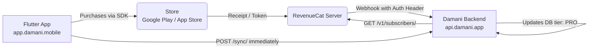

# Complete Setup Guide: Google Play Console, Apple App Store Connect & RevenueCat

This guide provides end-to-end, production-ready instructions for configuring **Google Play Console**, **Apple App Store Connect**, and the **RevenueCat Dashboard** for **Damani AI**.

---

## 📌 Project Specifications & Configuration Reference

Before beginning, keep these project-specific constants handy:

| Setting | Value in App | Description |
| :--- | :--- | :--- |
| **Android Package Name** | `app.damani.mobile` | Declared in `android/app/build.gradle.kts` |
| **iOS Bundle Identifier** | `app.damani.mobile` | Declared in `ios/Runner.xcodeproj` & `Info.plist` |
| **App Name** | `Damani AI` | Display name on both stores |
| **Entitlement Identifier** | `pro_access` | RevenueCat entitlement required by app and backend |
| **Yearly Product ID** | `pro_yearly` | Annual billing package ($229.00 / year) |
| **Monthly Product ID** | `pro_monthly` | Monthly billing package ($22.00 / month) |
| **Offering Identifier** | `default` | Default offering containing `$rc_annual` & `$rc_monthly` |
| **Backend Base URL** | `https://api.damani.app` | Production API server |
| **Backend Webhook Endpoint** | `https://api.damani.app/api/v1/subscriptions/revenuecat-webhook/` | Receives subscription lifecycle events from RevenueCat |
| **Post-Purchase Sync API** | `POST /api/v1/subscriptions/sync/` | Immediate client-driven sync after purchase/restore |
| **App User ID Contract** | User Email (e.g. `user@example.com`) | App calls `Purchases.logIn(email)` before purchase |

---

## 🧭 Flow Overview



---

# Part 1: Google Play Console Setup (Android)

### Prerequisites:
- A registered **Google Play Developer Account**.
- A completed **Google Payments Merchant Profile** (Settings ➔ Developer account ➔ Payment settings) linked to your Play Console to accept subscription payments.

---

### Step 1.1: Upload an Initial Build to an Internal Testing Track
Google Play will **not** allow creating in-app subscriptions until the package name `app.damani.mobile` has at least one build uploaded that declares billing permission (`com.android.vending.BILLING` is automatically added by the `purchases_flutter` plugin).

1. Build an App Bundle:
   ```bash
   flutter build appbundle --release
   ```
2. Log in to [Google Play Console](https://play.google.com/console).
3. Select or create the app: **Damani AI** (Package name: `app.damani.mobile`).
4. In the left menu, navigate to **Testing** ➔ **Internal testing**.
5. Click **Create new release**, upload the `.aab` file from `build/app/outputs/bundle/release/app-release.aab`, and rollout the release to the Internal track.

---

### Step 1.2: Create Subscriptions in Google Play Console

1. In Google Play Console, go to **Monetize** ➔ **Products** ➔ **Subscriptions**.
2. Click **Create subscription**.

#### 1. Yearly Subscription (`pro_yearly`):
- **Subscription ID:** `pro_yearly`
- **Name:** `Damani Pro Yearly`
- Under **Base plans**, click **Add base plan**:
  - **Base plan ID:** `pro-yearly-base` (or `pro_yearly`)
  - **Type:** `Auto-renewing`
  - **Billing period:** `1 Year`
  - **Grace period:** `16 days` (recommended to prevent accidental churn)
  - **Customer changes:** Keep defaults
  - **Price:** Click **Set prices**, choose USD and enter **$229.00** (Play Console will auto-calculate international currencies).
- Click **Save** and then click **Activate** on the base plan.

#### 2. Monthly Subscription (`pro_monthly`):
- Click **Create subscription** again.
- **Subscription ID:** `pro_monthly`
- **Name:** `Damani Pro Monthly`
- Under **Base plans**, click **Add base plan**:
  - **Base plan ID:** `pro-monthly-base` (or `pro_monthly`)
  - **Type:** `Auto-renewing`
  - **Billing period:** `1 Month`
  - **Grace period:** `7 days`
  - **Price:** Click **Set prices**, choose USD and enter **$22.00**.
- Click **Save** and then click **Activate** on the base plan.

---

### Step 1.3: Create Google Cloud Service Account & Link to Play Console
RevenueCat needs server-to-server access to validate Google receipts and track renewals.

1. In Google Play Console, go to **Settings** ➔ **Developer account** ➔ **API access**.
2. If prompted, link an existing Google Cloud project or create a new one (e.g. `damani-ai-cloud`).
3. Under **Service accounts**, click **Learn how to create service accounts** or go directly to the [Google Cloud Console Service Accounts](https://console.cloud.google.com/iam-admin/serviceaccounts).
4. Select your project and click **+ Create Service Account**:
   - **Service account name:** `revenuecat-service-account`
   - **Service account ID:** `revenuecat-service-account`
   - Click **Create and Continue**.
5. Assign Roles:
   - Select **Pub/Sub Admin** (or `Pub/Sub Publisher` + `Pub/Sub Subscriber`).
   - Click **Continue** and then **Done**.
6. Generate JSON Key:
   - Click on the newly created service account ➔ go to the **Keys** tab.
   - Click **Add Key** ➔ **Create new key** ➔ select **JSON** ➔ click **Create**.
   - Download the generated JSON key file securely (e.g. `damani-revenuecat-google-key.json`). You will upload this to RevenueCat.
7. Grant Permissions in Play Console:
   - Return to Google Play Console ➔ **API access**.
   - Locate the service account under **Service accounts** and click **Manage Play Console permissions** (or invite user).
   - In the **App permissions** tab, add **Damani AI** (`app.damani.mobile`).
   - In the **Financial permissions** tab, check:
     - ✅ **View financial data, orders, and cancellation survey responses**
     - ✅ **Manage orders and subscriptions**
   - Click **Apply** and then **Save changes** / **Invite user**.

---

### Step 1.4: Enable Real-Time Developer Notifications (Google Cloud Pub/Sub)
This allows Google Play to immediately notify RevenueCat when a renewal, cancellation, or chargeback occurs.

1. Go to [Google Cloud Pub/Sub Console](https://console.cloud.google.com/cloudpubsub/topic/list).
2. Click **Create Topic**:
   - **Topic ID:** `revenuecat-rtdn-topic`
   - Leave default encryption settings and click **Create**.
3. Grant Publish permission to Google Play:
   - Select the topic `revenuecat-rtdn-topic`.
   - In the info panel on the right, click **Permissions** ➔ **Add Principal**.
   - **New principals:** `google-play-developer-notifications@system.gserviceaccount.com`
   - **Role:** `Pub/Sub Publisher`
   - Click **Save**.
4. Configure in Play Console:
   - Go to Google Play Console ➔ **Monetize** ➔ **Monetization setup**.
   - In the **Real-time developer notifications** section:
     - Check **Turn on real-time developer notifications**.
     - **Topic name:** Enter the full topic path:  
       `projects/<YOUR_GOOGLE_CLOUD_PROJECT_ID>/topics/revenuecat-rtdn-topic`
   - Click **Send test notification** to verify, then click **Save changes**.

---

### Step 1.5: Set up License Testers
1. In Google Play Console, go to **Settings** ➔ **License testing**.
2. Add the Gmail addresses of your testers.
3. Set **License test response** to `RESPOND_NORMALLY`.
4. Ensure these testers are also added to the **Internal testing** track's tester list so they can download the test build. (In-app subscriptions purchased by license testers will renew every few minutes and will not charge real money).

---

# Part 2: Apple App Store Connect Setup (iOS)

### Prerequisites:
- An **Apple Developer Program** account.
- Complete the **Paid Applications Schedule** (Agreements, Tax, and Banking) under [App Store Connect ➔ Business](https://appstoreconnect.apple.com/business). Subscriptions will fail to load if this agreement is pending or expired.

---

### Step 2.1: Create Subscription Group & In-App Purchases

1. Log in to [App Store Connect](https://appstoreconnect.apple.com).
2. Go to **Apps** ➔ Select **Damani AI** (`app.damani.mobile`).
3. In the sidebar under **Monetization**, click **Subscriptions**.
4. Under **Subscription Groups**, click **Create**:
   - **Group Reference Name:** `Damani Pro Subscriptions`
   - Click **Create**.

#### 1. Yearly In-App Purchase (`pro_yearly`):
1. In the group, click **Create** under Subscriptions.
2. **Reference Name:** `Pro Yearly`
3. **Product ID:** `pro_yearly`
4. Click **Create**.
5. Configure Subscription Details:
   - **Subscription Duration:** Select `1 Year`.
   - **Subscription Availability:** Select countries/regions (All).
   - **Subscription Prices:** Click **Add Price** ➔ select **United States (USD)** ➔ choose the tier for **$229.00** ➔ click **Next** and **Save**.
   - **Localizations:** Click **+** next to App Store Localization (English):
     - **Subscription Display Name:** `Pro Yearly`
     - **Description:** `Full unlimited access to Damani AI features and priority support.`
   - **Review Information:** Upload a screenshot of the app's Paywall screen (`SubscriptionView`) and optional review notes.
6. Click **Save**.

#### 2. Monthly In-App Purchase (`pro_monthly`):
1. Return to the `Damani Pro Subscriptions` group and click **Create** under Subscriptions.
2. **Reference Name:** `Pro Monthly`
3. **Product ID:** `pro_monthly`
4. Click **Create**.
5. Configure Subscription Details:
   - **Subscription Duration:** Select `1 Month`.
   - **Subscription Prices:** Choose USD **$22.00**.
   - **Localizations:**
     - **Subscription Display Name:** `Pro Monthly`
     - **Description:** `Monthly access to Damani AI features and priority support.`
   - **Review Information:** Upload paywall screenshot.
6. Click **Save**.

> 💡 **Subscription Level Ordering:** In the subscription group, drag `Pro Yearly` to Level 1 and `Pro Monthly` to Level 2 (or set appropriate upgrade/downgrade order).

---

### Step 2.2: Generate In-App Purchase Key (StoreKit 2)
RevenueCat strongly recommends using the official App Store Connect In-App Purchase Key for fastest validation and refund tracking.

1. In App Store Connect, go to **Users and Access** ➔ **Integrations** tab.
2. Under **In-App Purchase**, click **+** (Generate In-App Purchase Key):
   - **Name:** `RevenueCat In-App Purchase Key`
3. Click **Generate**.
4. Note the **Key ID** and your **Issuer ID** (at the top of the page).
5. Click **Download API Key** (file format `.p8`). Save this file; Apple allows downloading it only once!

*(Alternative fallback: You can also use the **App-Specific Shared Secret** located in App Store Connect ➔ Apps ➔ Damani AI ➔ Subscriptions ➔ App-Specific Shared Secret).*

---

### Step 2.3: Configure App Store Server Notifications V2
1. In App Store Connect, go to **Apps** ➔ **Damani AI** ➔ **App Information**.
2. Scroll to **App Store Server Notifications**.
3. Under **Production Server URL**, click **Set Up URL**:
   - URL: `https://api.revenuecat.com/v1/subscribers/apple_server_notification`
   - Version: Select **Version 2**.
4. Under **Sandbox Server URL**, click **Set Up URL**:
   - URL: `https://api.revenuecat.com/v1/subscribers/apple_server_notification`
   - Version: Select **Version 2**.
5. Click **Save**.

---

### Step 2.4: Set up Apple Sandbox Testers
1. In App Store Connect, go to **Users and Access** ➔ **Sandbox Testers** (under Testing).
2. Click **+** to add a new tester (e.g. `testuser@example.com`).
3. Set password, Secret Question, and Region.
4. On a physical iOS testing device, go to **Settings** ➔ **App Store** ➔ scroll to the bottom ➔ sign into **Sandbox Account** with these tester credentials.

---

# Part 3: RevenueCat Dashboard Configuration

### Step 3.1: Create Project & Configure Apps

1. Log in to [RevenueCat Dashboard](https://app.revenuecat.com/).
2. Click **+ Create new project** (or select existing project) ➔ Name: **Damani AI**.
3. Click **Project Settings** ➔ **Apps**.

#### A. Configure Google Play App:
1. Click **+ New app** ➔ select **Google Play**.
2. **App name:** `Damani AI (Android)`
3. **Google Play package name:** `app.damani.mobile`
4. **Service account credentials JSON:** Upload the JSON file downloaded in Step 1.3 (`damani-revenuecat-google-key.json`).
5. **Real-time Developer Notifications (RTDN):**
   - Check **Connect to Google Cloud Pub/Sub**.
   - Enter your topic ID: `revenuecat-rtdn-topic`
   - Enter your Google Cloud Project ID.
6. Click **Save Changes**.

#### B. Configure App Store App:
1. Click **+ New app** ➔ select **App Store**.
2. **App name:** `Damani AI (iOS)`
3. **Bundle ID:** `app.damani.mobile`
4. **App Store Connect In-App Purchase Key (.p8):**
   - Upload the `.p8` file downloaded in Step 2.2.
   - Enter the **Key ID** and **Issuer ID**.
   *(If using Shared Secret: paste the App-Specific Shared Secret in the secret field).*
5. Click **Save Changes**.

---

### Step 3.2: Configure Entitlements, Products & Offerings

#### 1. Create Entitlement (`pro_access`):
1. In RevenueCat, click **Product catalog** ➔ **Entitlements**.
2. Click **+ New entitlement**.
3. **Identifier:** `pro_access` *(MUST be exact; this is checked in `RevenueCatService.entitlementId`)*.
4. **Description:** `Pro Access`
5. Click **Save**.

#### 2. Create Products:
1. Go to **Product catalog** ➔ **Products**.
2. Click **+ New product**:
   - **Identifier:** `pro_yearly`
   - **App:** Select `Damani AI (Android)` ➔ Choose Google Play subscription `pro_yearly` (Base plan: `pro-yearly-base`).
   - Click **Save**.
   - In the same product, click **Attach** next to `Damani AI (iOS)` ➔ Choose App Store product `pro_yearly`.
   - Under **Entitlements**, attach `pro_access`.
3. Click **+ New product** again:
   - **Identifier:** `pro_monthly`
   - **App:** Select `Damani AI (Android)` ➔ Choose Google Play subscription `pro_monthly` (Base plan: `pro-monthly-base`).
   - Attach App Store product `pro_monthly`.
   - Under **Entitlements**, attach `pro_access`.

#### 3. Create Default Offering:
1. Go to **Product catalog** ➔ **Offerings**.
2. If an offering named `default` exists, click it; otherwise click **+ New offering** with identifier `default`.
3. Add Packages:
   - Click **+ New package**:
     - **Identifier:** `$rc_annual` (Annual)
     - **Attach product:** Select `pro_yearly`.
   - Click **+ New package**:
     - **Identifier:** `$rc_monthly` (Monthly)
     - **Attach product:** Select `pro_monthly`.
4. Ensure this offering is set as the **Current Offering**.

---

### Step 3.3: Configure Webhook to Damani Backend

1. In RevenueCat Dashboard, go to **Project Settings** ➔ **Integrations** ➔ **Webhooks**.
2. Click **+ New webhook**:
   - **Webhook URL:** `https://api.damani.app/api/v1/subscriptions/revenuecat-webhook/`
   - **Authorization header:**
     Configure the authorization header agreed with the backend team. For example:
     ```text
     Bearer YOUR_REVENUECAT_WEBHOOK_SHARED_SECRET
     ```
     *(The backend validates this header to reject forged requests per issue #1 in `BACKEND_REVENUECAT_ISSUES.md`).*
3. **Events to send:**
   Check all relevant events:
   - ✅ `Initial Purchase` (`INITIAL_PURCHASE`)
   - ✅ `Renewal` (`RENEWAL`)
   - ✅ `Cancellation` (`CANCELLATION`)
   - ✅ `Expiration` (`EXPIRATION`)
   - ✅ `Billing Issue` (`BILLING_ISSUE`)
   - ✅ `Product Change` (`PRODUCT_CHANGE`)
   - ✅ `Uncancellation` (`UNCANCELLATION`)
   - ✅ `Transfer` (`TRANSFER`)
4. **Environment:** Send both `Sandbox` and `Production` events.
5. Click **Save**.
6. Click **Send Test Event** to verify that `https://api.damani.app/api/v1/subscriptions/revenuecat-webhook/` responds with `200 OK`.

---

### Step 3.4: Obtain Public SDK Keys
1. In RevenueCat Dashboard, go to **Project Settings** ➔ **API Keys**.
2. Under **Public API keys**:
   - Copy the Google key (starts with `goog_...`).
   - Copy the Apple key (starts with `appl_...`).

---

# Part 4: Flutter App Integration & Verification

### Step 4.1: Update `.env` in Flutter Project

Open your `.env` file (`d:\Ismail_flutter\julkar_vai\.env`) and replace the placeholders:

```env
# RevenueCat Public SDK Keys
REVENUECAT_GOOGLE_KEY=goog_xxxxxxxxxxxxxxxxxxxxxxxxxxxx
REVENUECAT_APPLE_KEY=appl_xxxxxxxxxxxxxxxxxxxxxxxxxxxx
```

> ⚠️ **Note:** Never commit private service keys (`.json` or `.p8`) into the Flutter app repository. Only the public keys starting with `goog_` and `appl_` belong in the Flutter `.env`.

---

### Step 4.2: End-to-End Test Execution Checklist

Follow this checklist on a physical device or emulator to verify the entire loop:

| Step | Action | Expected Result |
| :---: | :--- | :--- |
| **1** | Open app and log in as `reviewer.investor@damani.app` (or any real account). | `RevenueCatService.logIn(email)` executes; `StorageService.getUserEmail()` returns email. |
| **2** | Navigate to Settings ➔ Tap **Subscription Plan** (`/subscription`). | `SubscriptionView` loads. Offerings are retrieved from RevenueCat and backend plans from `/api/v1/subscriptions/plans/`. Plan cards display store prices. |
| **3** | Select **Yearly** ($229) and tap **Get Pro**. | Native Google Play or Apple App Store payment bottom sheet appears with test card / sandbox account. |
| **4** | Cancel the native sheet. | The sheet closes gracefully. No error snackbar is displayed. |
| **5** | Tap **Get Pro** again and approve the purchase. | Purchase succeeds. `POST /api/v1/subscriptions/sync/` is immediately called with `{"source": "purchase"}`. Success snackbar is shown. |
| **6** | Navigate back to Profile or Settings screen. | Top profile badge displays **"Pro Member"** with blue/purple styling. Settings shows `PRO`. |
| **7** | Check RevenueCat Customer Dashboard. | Search user by email (`reviewer.investor@damani.app`). Shows active `pro_access` entitlement. |
| **8** | Check Backend Database / Logs. | Webhook `POST /api/v1/subscriptions/revenuecat-webhook/` received with valid `Authorization` header and updated user tier to `PRO`. |
| **9** | Reopen `/subscription` and tap **Restore Purchases**. | `RevenueCatService.restore()` restores entitlement; `POST /api/v1/subscriptions/sync/` is called with `{"source": "restore"}`. |

---

# Part 5: Common Issues & Troubleshooting

| Symptom | Cause | Solution |
| :--- | :--- | :--- |
| **"No subscription plans are available right now" / Empty Offerings** | Offerings or Products are not linked properly in RevenueCat, or Google Play / App Store products are not yet active. | 1. Check RevenueCat ➔ Offerings ➔ Verify `default` has `$rc_annual` and `$rc_monthly`.<br>2. Ensure Paid Applications Schedule is active in App Store Connect.<br>3. Ensure Google Play subscriptions have active base plans and the app is uploaded to at least the Internal Testing track. |
| **Google Play: "The item you requested is not available for purchase"** | The device account is not added as a tester, or the build on device has a different version or signature. | Add tester email under **License testing** in Play Console, download the build via the internal testing link. |
| **App Store: Cannot connect to iTunes Store** | Missing In-App Purchase capability in Xcode, or tester is not logged in under Settings ➔ App Store ➔ Sandbox Account. | Sign into Sandbox Account in iOS Settings. Verify Bundle ID matches `app.damani.mobile`. |
| **Purchases are assigned to `$RCAnonymousID` instead of user email** | `Purchases.logIn(email)` did not run before purchasing. | Already guarded in `SubscriptionNotifier.subscribe()` and `restore()`. Ensure the user has an email stored upon authentication. |
| **Webhook returns 401 Unauthorized** | RevenueCat webhook header does not match backend secret. | Verify the `Authorization` header configured in RevenueCat Webhook settings matches the backend's expected token. |
| **Client self-upgrade vulnerability** | Client attempts to PATCH `subscription_tier`. | Ensure backend has marked `subscription_tier` read-only in serializers (Issue #2). Only the webhook or `/subscriptions/sync/` should update the tier. |
